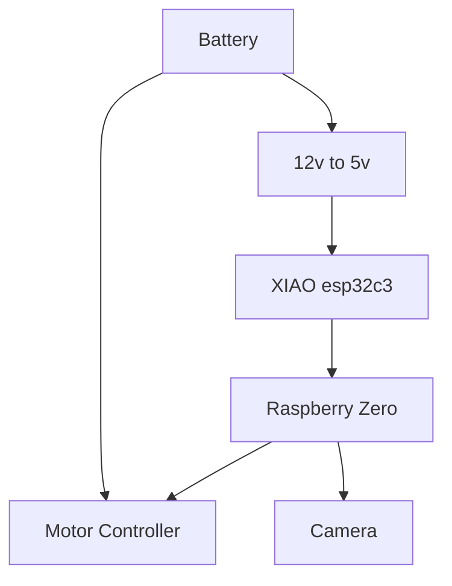
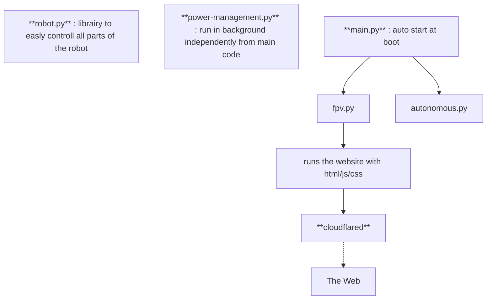
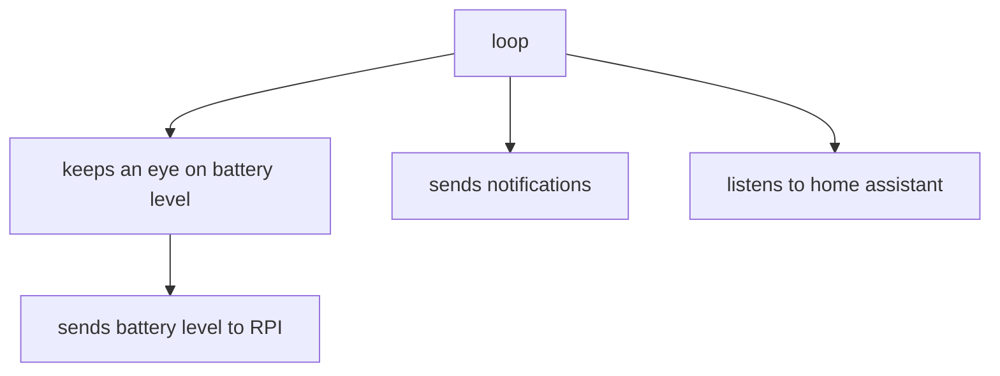

### ⚡️ **CAMOVER**    
CAMOVER, for *camera-rover*.

----
### Features
- based on a RPI Zero 2 W
- remotly controlled via any connected device any where on the world via a simple website
- simple controls : turn left/right, forward, backward, speed, etc
- send notification throught ntfy
- power management from a tiny micro-controller (XIAO esp32c3) : remtly shutdown or powerup the RPI via home assistant
- realtime battery usage viewer via the XIAO
- (planned) use game controller such as steering wheel
- (planned) see how many people are connected to the website
- (planned) make it autonomous with self hosted ia/simple machine learning
- (planned) better power management, with notifications

### Hardware

### Software

**Raspberry Zero**

Two modes : fpv (remtoly controlled) or autonomous (autonomous via ia/machine learning)

**XIAO esp32c3**

### Previews

