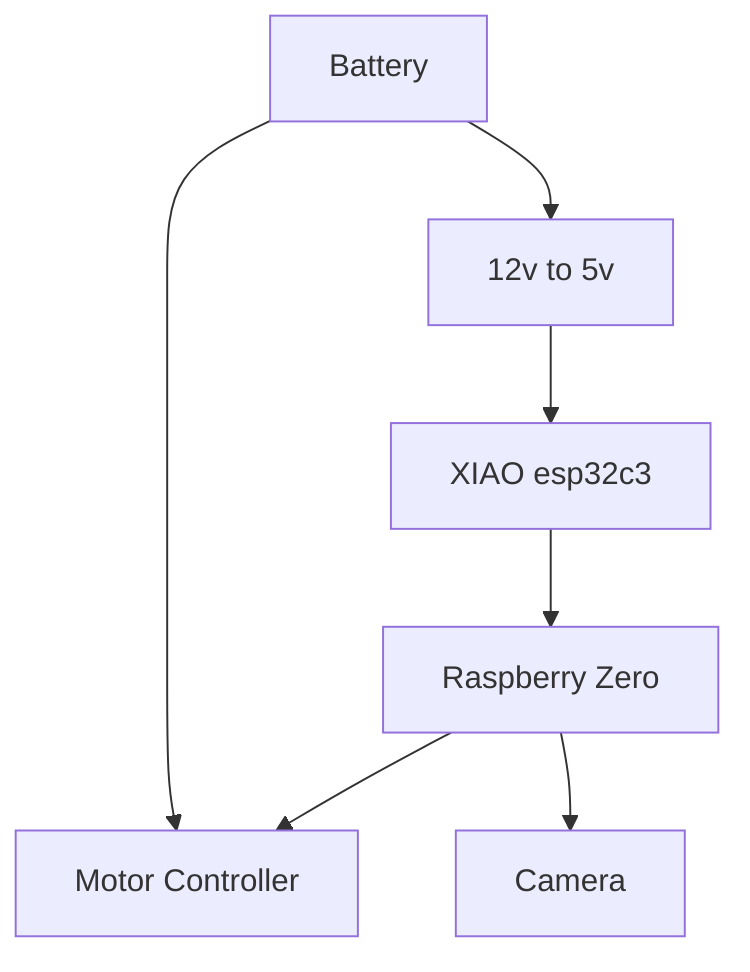
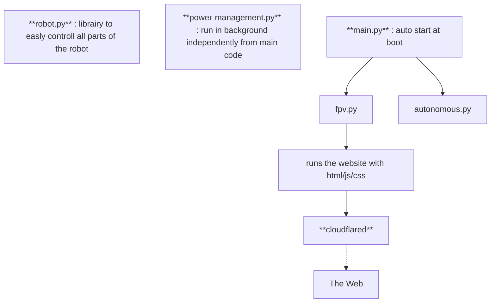
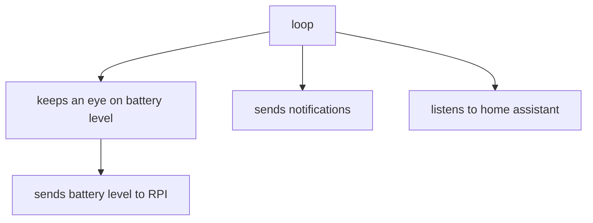

### ⚡️ **CAMOVER**    
CAMOVER, for *camera-rover*.

----
### ✅️ Features
- based on a RPI Zero 2 W
- remotly controlled via any connected device any where on the world via a simple website
- simple controls : turn left/right, forward, backward, speed, etc
- send notification throught ntfy
- power management from a tiny micro-controller (XIAO esp32c3) : remtly shutdown or powerup the RPI via home assistant
- realtime battery usage viewer via the XIAO
- (planned) use game controller such as steering wheel
- (planned) see how many people are connected to the website
- (planned) make it autonomous with self hosted ia/simple machine learning
- (planned) better power management, with notifications

### 🔌️ Hardware

**Components**
- camera 8 Mpx IMX219 B0390 
- motor controller MDD3A
- convertissor DC-DC 60 W DFR1025 
- Raspberry Pi Zero 2 W
- motors come from this [kit](https://www.dfrobot.com/product-1837.html)
- capacitors for stabilisation and filtering
- XIAO esp32c3
- standard relay
- 11.1V 2200mAh 25C lithium battery
- other random and cheap components like leds, etc

### 📜️ Software

**Raspberry Zero**

Two modes : fpv (remtoly controlled) or autonomous (autonomous via ia/machine learning)

**XIAO esp32c3**

### 📷️ Previews

Photo from the very beginning of the project

